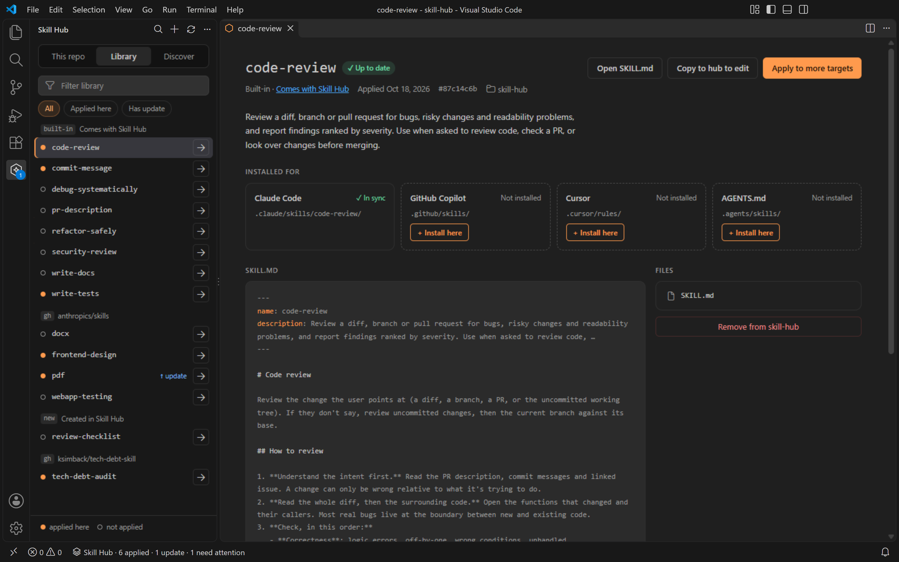
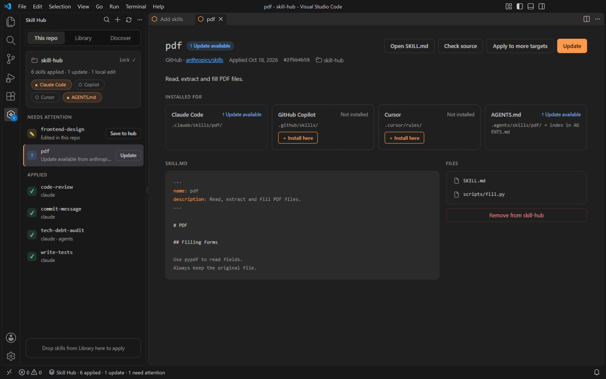
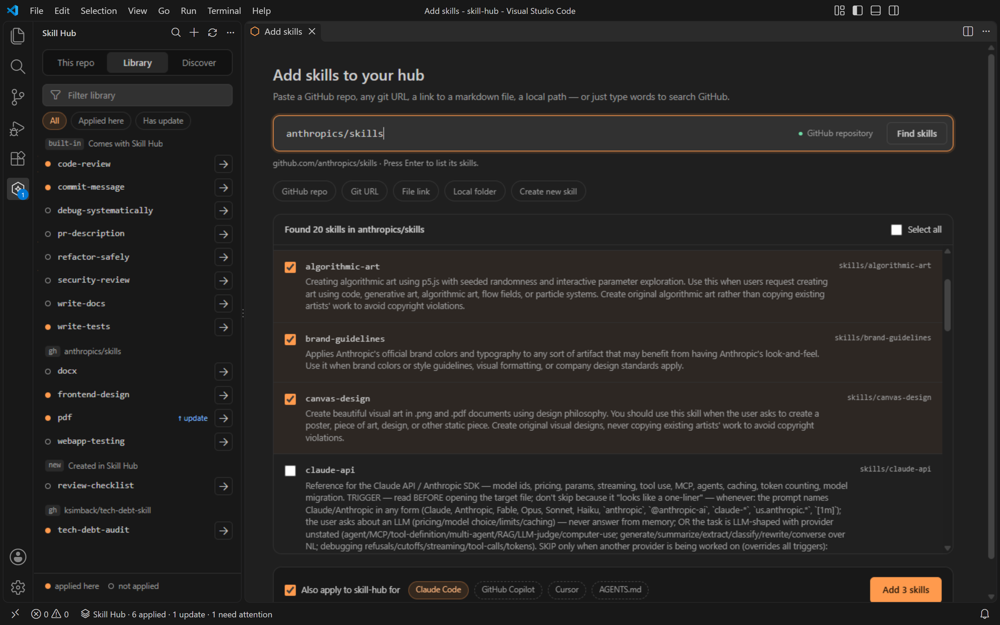
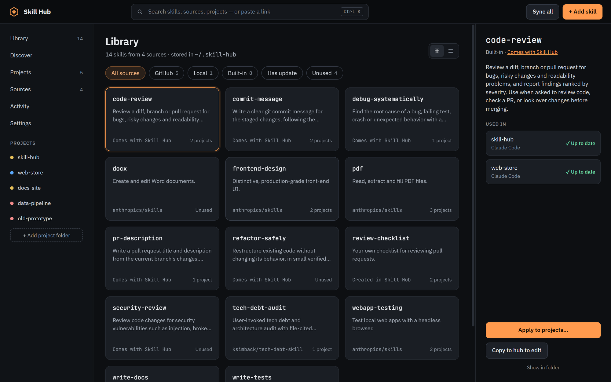
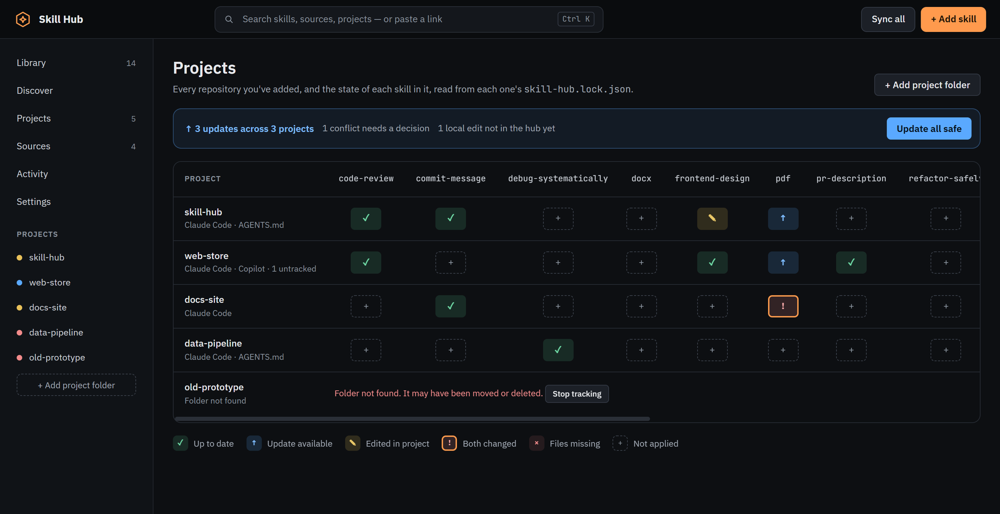

# Skill Hub

[](https://github.com/twentyTwo/skill-hub/actions/workflows/release.yml)

Keep one library of AI agent skills (`SKILL.md` folders), collected from anywhere, and apply them to your repositories for Claude Code, GitHub Copilot, Cursor, AGENTS.md-based agents, or any folder you configure.



<table>
  <tr>
    <td width="50%"></td>
    <td width="50%"></td>
  </tr>
  <tr>
    <td>VS Code: what this repository has, and what needs attention</td>
    <td>VS Code: paste a repo, tick the skills you want</td>
  </tr>
  <tr>
    <td width="50%"></td>
    <td width="50%"></td>
  </tr>
  <tr>
    <td>Desktop: the whole library</td>
    <td>Desktop: every project's skills in one matrix</td>
  </tr>
</table>

There are two apps. They share one hub (`~/.skill-hub`) and the same `skill-hub.lock.json` in each repository:

| Folder | What it is |
|---|---|
| [`vscode-extension/`](vscode-extension) | The VS Code extension. Works on the repository you have open: sidebar, skill detail and Add skills pages. |
| [`desktop/`](desktop) | The desktop app (Electron). Works across all your projects: Library, a Projects matrix, source checks, and conflict resolution. |
| [`design/`](design) | The UI spec (`DESIGN.md`), mockups, and `tokens.css`, which both apps import. |

The skill logic (sources, library, targets, lock file, status) lives in `vscode-extension/src/core` and has no VS Code imports. The desktop app imports it from there instead of keeping a copy, so a change to core needs both test suites:

```sh
cd vscode-extension && npm install && npm test
cd desktop && npm install && npm test
```

See each folder's README for details. In VS Code, the launch configurations **Run Extension** and **Run Desktop App** start each one.

## CI and releases

GitHub Actions in [`.github/workflows`](.github/workflows):

| Workflow | Runs on | What it does |
|---|---|---|
| `ci.yml` | Pull requests (and as the first step of the two below) | Extension: typecheck and unit tests on Linux and Windows, integration tests in VS Code and a `.vsix` artifact on Linux. Desktop: typecheck and tests. |
| `release.yml` | Push to `main`, or run by hand | Runs CI, then publishes the extension if `vscode-extension/package.json` has a version with no `v<version>` tag yet: VS Code Marketplace and Open VSX in parallel, then a GitHub release with the `.vsix` and that version's CHANGELOG section. A manual run can pick the marketplaces or republish an existing version. |
| `beta.yml` | Push to `develop` | Runs CI, then attaches `<version>-beta.<run>` as a `.vsix` to a GitHub pre-release. Betas don't go to the marketplaces. |

To release: bump `version` in `vscode-extension/package.json`, add a `## <version>` section to `vscode-extension/CHANGELOG.md`, and merge to `main`.

Publishing reads its credentials from two repository environments (**Settings → Environments**):

- **VS Code Marketplace**: the variables `AZURE_CLIENT_ID` and `AZURE_TENANT_ID` of a Microsoft Entra app registration. Give the app a federated credential for this repository with entity type *Environment* and the name `VS Code Marketplace`, then add the app as a member of the `noorashuvo` publisher at [marketplace.visualstudio.com/manage](https://marketplace.visualstudio.com/manage). If those variables aren't set, the job falls back to a `VSC_PAT` secret (an Azure DevOps token for *All accessible organizations* with the *Marketplace → Manage* scope), but such global tokens stop working on December 1, 2026.
- **Open VSX**: the secret `OPENVSX_PAT`, an access token from [open-vsx.org](https://open-vsx.org/user-settings/tokens) (sign in with GitHub and accept the publisher agreement first). The first release creates the `noorashuvo` namespace.
